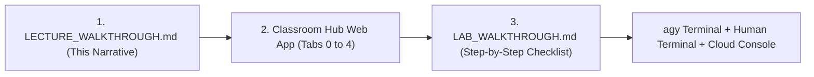
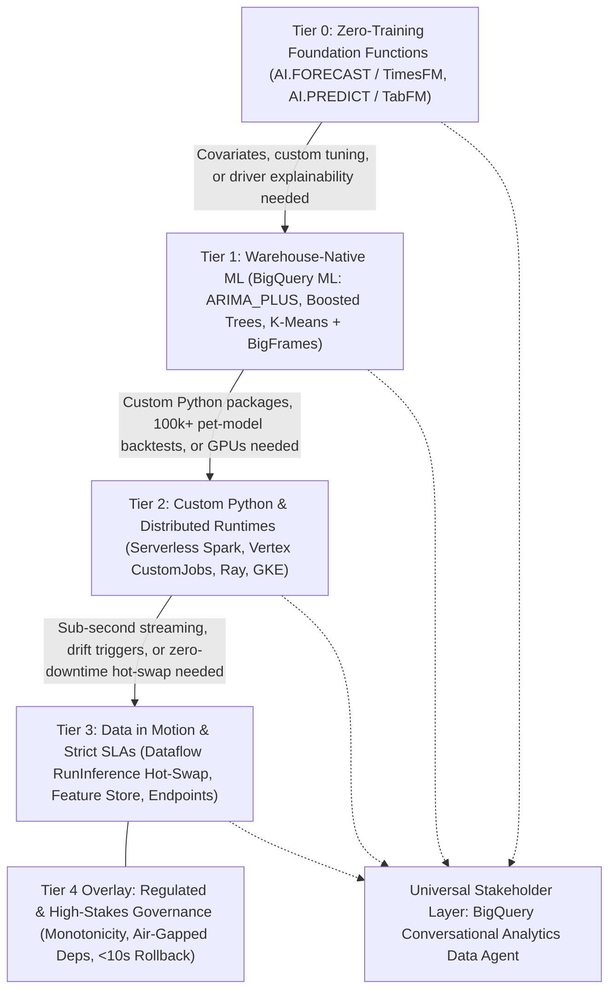
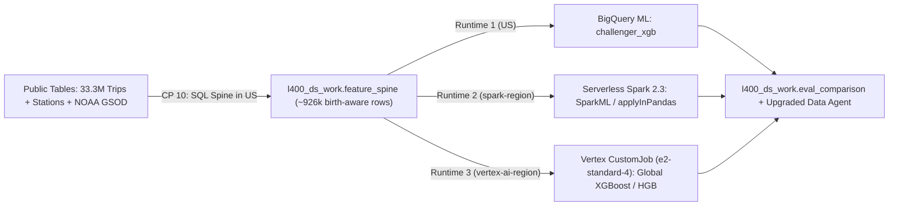

# L400 Agentic Data Science — Lecture & Narrative Walkthrough (`LECTURE_WALKTHROUGH.md`)

> **Companion to [`LAB_WALKTHROUGH.md`](LAB_WALKTHROUGH.md) & [`README.md`](README.md):**
> - **Want the terse, command-by-command checklist?** Open **[`LAB_WALKTHROUGH.md`](LAB_WALKTHROUGH.md)** alongside `agy`.
> - **Want the architectural *why*, classroom stories, Socratic questions, and live Console experiments?** Read this guide alongside the **[Classroom Hub UI](https://data-science-hub-463617135523.us-central1.run.app)**—every chapter hands off directly to the matching section of [`LAB_WALKTHROUGH.md`](LAB_WALKTHROUGH.md).

Welcome to **L400: Agentic Data Science**.

If you have already spotted the twelve verification checkpoints in the Classroom Hub, let's get one thing out of the way up front: **turning twelve checkboxes green is the least interesting part of this course.** Anyone can paste prompts into a coding agent until a script passes. What actually matters—whether you are leading a customer architecture session, scoping a proof of concept (PoC), or facilitating this workshop for peers—is learning *how to frame ambiguous business problems into bounded cloud systems* without getting lost in a zoo of coding agents picking random Python libraries and inventing brittle pipelines.

---

## Table of Contents

- **[0. How to Use This Guide (Three Surfaces, Two Audiences)](#0-how-to-use-this-guide-three-surfaces-two-audiences)**
- **Part I — Foundations & Pass 1: Guided Tier 0 Baseline (`Day 1 · Checkpoints 01–06`)**
  - **[1. Turning Data into Decisions & Systems Thinking](#1-turning-data-into-decisions--systems-thinking)** *(`0. Start & Setup` · `Checkpoint 01`)*
  - **[2. Inside the Harness: Bounding Coding Agents Before They Touch Data](#2-inside-the-harness-bounding-coding-agents-before-they-touch-data)** *(`Stage 1 Harness Tour`)*
  - **[3. `1. The Method`: The 4-Tier Escalation Ladder + Regulated Overlay](#3-1-the-method-the-4-tier-escalation-ladder--regulated-overlay)** *(`1. The Method`)*
  - **[4. Pass 1 Discovery: Bounding Demand Forecasting & Operational Fallacies](#4-pass-1-discovery-bounding-demand-forecasting--operational-fallacies)** *(`2. Discovery` · `Checkpoint 02`)*
  - **[5. Pass 1 Agentic Design: Profiling Raw Data & The Blizzard Spine](#5-pass-1-agentic-design-profiling-raw-data--the-blizzard-spine)** *(`3. Agentic Design` · `Checkpoint 03`)*
  - **[6. Pass 1 Agentic Build: Zero-Shot Floor & Governed Data Agents](#6-pass-1-agentic-build-zero-shot-floor--governed-data-agents)** *(`4. Agentic Build` · `Checkpoints 04–06`)*
- **[Milestone Cutoff — Pass 1 (Guided Baseline · Day 1) to Pass 2 (Solo Escalation · Day 2)](#milestone-cutoff--pass-1-guided-baseline--day-1-to-pass-2-solo-escalation--day-2)**
- **Part II — Pass 2: Solo Tier 2 Multi-Runtime Escalation (`Day 2 · Checkpoints 07–12`)**
  - **[7. Pass 2 Escalation: Challenger Design & Raw-Data Trap Auditing](#7-pass-2-escalation-challenger-design--raw-data-trap-auditing)** *(`Tabs 2–3` · `Checkpoints 07–08`)*
  - **[8. Pass 2 Build: Authoring Skills & Running the 3-Runtime Cloud Tournament](#8-pass-2-build-authoring-skills--running-the-3-runtime-cloud-tournament)** *(`4. Agentic Build` · `Checkpoints 09–11` + 5 Chalk-Talk Sidebars)*
  - **[9. Pass 2 Showdown: Metrics, Multi-Winners, Backtesting & In-Place Agent Upgrade](#9-pass-2-showdown-metrics-multi-winners-backtesting--in-place-agent-upgrade)** *(`4. Agentic Build` · `Checkpoint 12`)*
  - **[10. Taking It to Monday Morning: Living Demos & Your Personal PoC Harness](#10-taking-it-to-monday-morning-living-demos--your-personal-poc-harness)** *(`After Class`)*
- **[11. Companion Reference & Deep-Link Index](#11-companion-reference--deep-link-index)**

---

## 0. How to Use This Guide (Three Surfaces, Two Audiences)

The course runs across three complementary surfaces so you never have to hunt through walls of UI text just to find your next command:



1. **`LECTURE_WALKTHROUGH.md` (This Guide):** Explains the *why*—the mental models, real-world customer failure modes, raw-data traps, runtime trade-offs, and live Console experiments behind every stage.
2. **The Classroom Hub ([`data-science-hub`](https://data-science-hub-463617135523.us-central1.run.app)):** Your visual mission control in the browser (`0. Start & Setup` → `1. The Method` → `2. Discovery & Architectures` → `3. Agentic Design` → `4. Agentic Build`), complete with interactive Tier mapping, architecture diagrams, 1-click Cloud Console deep links, and the 136-term **Solution Architect Field Guide**.
3. **[`LAB_WALKTHROUGH.md`](LAB_WALKTHROUGH.md):** Your terse, linear checklist open inside VS Code right beside your `agy` terminal. Whenever this narrative reaches a hands-on block, you will see a **Hands-On Handoff** pointing straight to the exact section of `LAB_WALKTHROUGH.md`.

### Who This Guide Is Written For
- **On-Demand & Self-Paced Learners:** Read each chapter to absorb the architectural framing, pause at the **Hands-On Handoff** to execute the checkpoint(s) in [`LAB_WALKTHROUGH.md`](LAB_WALKTHROUGH.md), and return here to unpack what your results mean before escalating.
- **Co-Instructors & Session Facilitators:** In live two-day deliveries, **Day 1 (~3–3.5 hours)** covers **Part I** (`Checkpoints 01–06`, 100% of Pass 1 Guided Tier 0), and **Day 2 (~2–2.5 hours)** covers **Part II** (`Checkpoints 07–12`, Pass 2 Solo Tier 2 + live Console showdown). Rather than lecturing for an hour and disappearing for three hours, pace the room using the **80% Cohort Gate**: watch the live facilitator board until ~80% of active participants clear a checkpoint block, bring the room back together for a 5-minute debrief while context is fresh, and launch the next stage together.

---

# Part I — Foundations & Pass 1: Guided Tier 0 Baseline (`Day 1 · Checkpoints 01–06`)

---

## 1. Turning Data into Decisions & Systems Thinking
**Hub Alignment:** `0. Start & Setup` · **Walkthrough:** [`Stage 0 — Environment Setup & Checkpoint 01`](LAB_WALKTHROUGH.md#stage-0--environment-setup--checkpoint-01-0-start--setup)

### You Do Not Need a PhD in Statistics—You Need Systems Thinking
Data science is simply **turning information into decisions**. Like a baseball team, it takes a roster of very different roles to win a game—and data discovery, data engineering, and pipeline architecture are half the roster.

Think of decision-making along a single spectrum:
- **Deterministic Business Rules (`if-then-else`):** For decades, enterprises built "decision engines" out of thousands of hand-written `if-then-else` statements. If you crack open a saved `XGBoost` gradient-boosted tree file, it looks surprisingly similar—splits and thresholds—except a machine learned those splits from historical data instead of a committee writing rules by hand.
- **Probabilistic Classical ML:** Regression (predicting `$100` vs. `$200`), classification (`Class A` vs. `Class B` or multi-label tagging), time-to-event survival analysis, clustering, and dimensionality reduction.
- **Generative & Foundation Models:** Pre-trained sequence, tabular, and decision APIs—including purpose-built endpoints like the [Gemini Decisions API](https://blog.google/innovation-and-ai/technology/developers-tools/gemini-decisions-api/)—where the model itself is often just an API call or a SQL function inside your data platform.

Most online tutorials convince people that data science lives inside a tiny box called `model.fit(df)`: load a clean CSV into Pandas, fit scikit-learn or PyTorch, celebrate an accuracy score, and go home. **In enterprise production, `model.fit()` is the easiest 5% of the job—and on its own, it is useless.** The hard 95% is operational:
- Where does fresh data come from tomorrow morning, and what happens when upstream schemas drift or a snowstorm shuts down the city?
- How do predictions land somewhere business teams can actually act on them without opening a notebook?
- How do you monitor drift, control cost, and retrain or roll back safely?

If you already think in terms of data pipelines, storage layers, and SQL transformations, **you are naturally a systems thinker**. A machine learning model is just one more component in a pipeline.

### The Three Realms of Customers—and Being "Personal Shoppers for Google Cloud"
When organizations bring data science problems to the table, they almost always fall into one of three realms:
1. **Realm 1 — Data-Rich, No Data Science Team:** They have rich operational tables in BigQuery and urgent business decisions to make, but zero ML engineers on staff. This is fertile ground for zero-training warehouse AI and Conversational Analytics.
2. **Realm 2 — Established Pipelines Looking to Modernize or Migrate:** They already run Python, Spark, or legacy statistical baselines elsewhere and want to know how Google Cloud runs—and improves—their workload without friction.
3. **Realm 3 — Deep Specialists Testing Your Credibility:** PhD-heavy quantitative and forecasting teams who will ask thirty pointed questions about hierarchical reconciliation, rolling-origin backtesting, or monotonic constraints in the first ten minutes. If you blurt out *"I heard the word forecasting—just run `AI.FORECAST`!"* without understanding their constraints, you lose the room immediately.

Google Cloud can run all three realms, which is simultaneously our greatest strength and our biggest trap. Because there are ten valid ways to run ML on Google Cloud, buyers get overwhelmed. **Our job as architects is to act as personal shoppers for Google Cloud**: listen to the business decision first, ask sharp boundary questions, and walk the customer down the shortest, cleanest path that actually solves their problem.

### Two Passes Over the Same Problem
To practice engaging both Realm 1 and Realm 2/3 buyers, this course solves the **same problem twice** (`Discover → Design → Build → Verify`):
- **Pass 1 — Guided (`Tier 0`, Checkpoints `01–06`):** Your customer has data and wants demand forecasts fast without managing ML pipelines. *Punchline #1:* Even "zero-training" foundation models still require real data engineering when raw tables hide silent calendar gaps—and enterprises still need governance around when forecasts change.
- **Pass 2 — Solo (`Tier 2`, Checkpoints `07–12`):** Now a skeptical customer data science team pushes back: *"We trust Holt-Winters, ARIMA, and gradient boosting with weather covariates—prove on our holdout split whether foundation models or custom runtimes win."* *Punchline #2:* Univariate zero-shot `TimesFM 2.5` won't win every segment once weather and station-level capacity enter the picture—and **that is completely okay**. Winning means running an honest, frictionless multi-runtime bake-off where every contender lands back in BigQuery.

### Why an Agentic Data Science Course Starts with Terraform (`deploy.sh`)
The very first command you run in this course is `source deploy.sh`, which provisions a clean Google Cloud project via Terraform. Should someone doing data science really ship Terraform with a PoC? **Yes—every single time.**

Nothing makes a customer resent a cloud PoC faster than handing them a README with twenty manual API enablement commands, IAM role bindings, bucket flags, and `gcloud` authentication traps. Bottling infrastructure complexity inside an idempotent script (`deploy.sh` automatically discovers an active billing account, enables BigQuery, Serverless Spark, Vertex AI, and Conversational Analytics APIs, provisions 4-region Cloud NAT networking, installs fresh agent skills, and verifies `Checkpoint 01`) eliminates setup friction so the conversation stays on data and decisions.

> [!TIP]
> **Field Workflow — Explore in a Sandbox, Author Terraform Incrementally:** When building a brand-new customer PoC from scratch, don't fight Terraform while you are still experimenting. Explore freely in a disposable sandbox project first. Once the architecture crystallizes, open a fresh project and have your coding agent build Terraform *incrementally* from your verified command history step-by-step—never trust an LLM to reverse-engineer an entire messy sandbox project in one shot.

### Hands-On Handoff — `Checkpoint 01`
1. Open [`LAB_WALKTHROUGH.md` → **Stage 0 — Environment Setup & Checkpoint `01`**](LAB_WALKTHROUGH.md#stage-0--environment-setup--checkpoint-01-0-start--setup).
2. Create your private repository from [`cloud-gtm/l400-agentic-data-science-labs`](https://github.com/cloud-gtm/l400-agentic-data-science-labs), clone it locally, open two terminals (`Terminal 1` for `agy`, `Terminal 2` as your **Human Terminal**), and kick off:
   ```bash
   source deploy.sh
   ```
3. **Do not wait idly while Terraform runs (~3–4 minutes).** Read Chapter 2 and Chapter 3 right now while APIs propagate in the background, then paste your generated `l400-agentic-ds-<id>` project ID into the Hub header pill (`☁️ Set Project ID`) and confirm `Checkpoint 01` is green.

---

## 2. Inside the Harness: Bounding Coding Agents Before They Touch Data
**Hub Alignment:** `0. Start & Setup` & Workspace · **Walkthrough:** [`Stage 1 — Up-Front Harness Tour`](LAB_WALKTHROUGH.md#stage-1--up-front-harness-tour-how-this-repo-bounds-agy)

Left unguarded on a data science prompt, modern coding agents behave predictably badly: they `pip install` conflicting libraries globally, download 30 million BigQuery rows onto a laptop VM until memory crashes, invent deprecated Docker container URIs from two years ago, leak future target columns into lag features, or read the grading script instead of doing the work.

An **Agent Harness** (`LLM + Tools + Context Index + Rules + Deterministic Hooks + Domain Skills`) keeps the coding agent fast, accurate, and inside architectural rails. While `deploy.sh` finishes, inspect the five building blocks inside your cloned workspace (`Stage 1` of [`LAB_WALKTHROUGH.md`](LAB_WALKTHROUGH.md#stage-1--up-front-harness-tour-how-this-repo-bounds-agy)):

### 1. Fast Orientation & Contract (`docs/llms.txt` & `AGENTS.md`)
- **`docs/llms.txt`:** A ~40-line navigation index read first by coding agents so `agy` immediately knows where files, datasets, rules, and skills live instead of burning five minutes grepping directories blindly.
- **`AGENTS.md`:** Your master workflow contract enforcing `Discover → Design → Approval Gate → Build → Verify` (with lightweight compatibility pointers in `CLAUDE.md`, `.cursorrules`, and `.windsurfrules` so you can switch across editors and CLIs cleanly). Notice that **`AGENTS.md` and `.agents/rules/` contain zero hardcoded NYC Citi Bike business logic**—they define reusable data science engineering standards that work across all 9 enterprise archetypes in the Hub.

### 2. Probabilistic Rules vs. Deterministic Hooks (`.agents/rules/*.md`)
Inside `.agents/rules/`, five compact (`< 12 KB`) Markdown files stay loaded in context:
- **`lab_governance.md`:** Enforces mandatory human `DESIGN` approval gates before code execution, forbids local VM model training (`.to_pandas()` on raw tables), and isolates `./lab-evaluation-verifier/` so `agy` never reads or runs the grading scripts. *(Classroom contrast: because Markdown rules are **probabilistic** instructions to an LLM, pasting a verifier command into `agy` triggers stern refusal warnings—whereas in production starter harnesses like [`statmike/agent-repo-template`](https://github.com/statmike/agent-repo-template), anything requiring **100% deterministic enforcement**, such as blocking `pip install` in favor of `uv` or blocking accidental secret commits, runs as executable Python `PreToolUse` hooks like `guard_uv.py` and `guard_secrets.py` wired into `.claude/settings.json` / `.agents/hooks.json`.)*
- **`data_science_standards.md` & `bigquery_ai_and_ml_standards.md`:** Act as traffic cops—preferring stable Google Cloud REST APIs over brittle SDK wrappers, enforcing leak-free temporal splits, routing Tier 0/1 SQL to specific skills, and capping classroom hyperparameters (`max_iterations = 20`, `e2-standard-4` machines) so your cloud training jobs finish in **5–14 minutes** rather than burning two hours.
- **`agent_skills_standards.md` & `terraform_standards.md`:** Standardize modular `.agents/skills/<name>/SKILL.md` packaging and multi-region failover (`us-central1`, `us-east1`, `us-east4`, `us-west1`).

### 3. Progressive Disclosure in Domain Skills (`.agents/skills/`)
A single monolithic "do all of data science" prompt file either blows up your context window or stays too generic to write working SQL. Instead, `deploy.sh` installs two external, actively maintained skill suites alongside the repo's built-in skills (`discovery-pack-fetch` and `conversational-analytics-agent`):
1. **[Google Cloud Data Agent Kit (`DAK`)](https://github.com/GoogleCloudPlatform/data-agent-kit-plugin):** Open `.agents/skills/bigquery-ai-ml/SKILL.md` in VS Code. Notice **two-hop progressive disclosure**: `SKILL.md` gives `agy` a concise decision index at the top, and only when the agent decides it needs semantic aggregation or forecasting does it read `references/ai_agg.md` or `references/ai_forecast.md` for exact TVF syntax. *(Human pro-tip: browsing `.agents/skills/bigquery-ai-ml/references/` in VS Code is often faster for a human architect on a live call than clicking across twenty separate documentation pages!)*
2. **[`statmike/bigquery-data-science`](https://github.com/statmike/bigquery-data-science) (4-Skill Suite):** Complements DAK with opinionated data science routing across four skills (`bigquery-data-science` router, `bigquery-ai` covering 31+ `AI.*` functions + 1:1 SQL-to-BigFrames maps, `bigquery-ml` covering trained [`ARIMA_PLUS`](https://github.com/statmike/bigquery-data-science/tree/main/bigquery-ml/models/arima_plus) / [`ARIMA_PLUS_XREG`](https://github.com/statmike/bigquery-data-science/tree/main/bigquery-ml/models/arima_plus_xreg) / tree workflows + SQL survival analysis recipes, and `bigquery-mlops`), structured in three layers: **`SKILL.md` router → surgical `.sql` syntax cards → worked end-to-end notebooks**. It also captures production nuances missing from standard docs (such as how `AI.*` functions handle `NULL` missingness differently on `INT64` vs. `FLOAT64` columns) and updates continuously as BigQuery launches or graduates functions like [`AI.PARSE_DOCUMENT`](https://github.com/statmike/bigquery-data-science/blob/main/bigquery-ai/functions/ai_parse_document/ai_parse_document.ipynb) and [`AI.CHUNK_DOCUMENT`](https://github.com/statmike/bigquery-data-science/blob/main/bigquery-ai/functions/ai_chunk_document/ai_chunk_document.ipynb).

> [!IMPORTANT]
> **Why `deploy.sh` Installs Skills Dynamically:** In this classroom template, `deploy.sh` fetches fresh skill bundles into gitignored paths so a template cloned months later never ships stale SQL syntax. On real developer workstations, install the Data Agent Kit IDE plugin directly so skills update without re-running infrastructure scripts—and **always run `./lab-evaluation-verifier/*.py` strictly in your Human Terminal**, never inside `agy`.

### 4. Multi-Region Cloud State (`agent-config.json`)
Generated automatically by `deploy.sh` (and gitignored so you never commit your project ID), `agent-config.json` separates three regional keys right from the start:
- `bigquery-region`: `"US"` (multi-region data plane matching `bigquery-public-data`)
- `spark-region`: `"us-central1"` (Serverless Spark batches)
- `vertex-ai-region`: `"us-central1"` (CustomJobs & Model Registry)

---

## 3. `1. The Method`: The 4-Tier Escalation Ladder + Regulated Overlay
**Hub Alignment:** `1. The Method` · **Walkthrough:** [`Stage 2 — Method & Discovery Orientation`](LAB_WALKTHROUGH.md#stage-2--method--discovery-orientation-tabs-1--2)

Suppose you ask a room of cloud architects to name every place you can run machine learning on Google Cloud: *BigQuery `AI.*`, BigQuery ML, BigFrames, Serverless Spark, Vertex AI CustomJobs, Tabular Workflows, Ray on Vertex or GKE, Cloud Run, Dataflow.*

Now: **which runtime are you going to use right now?**

Trick question—**you cannot answer yet, because you don't know the business question and you don't know the operational boundaries.** Pitching a Tier 3 streaming Kafka/Dataflow MLOps pipeline to a buyer who just needs a monthly regional inventory forecast is **"selling past the sale"**—you scare 90% of stakeholders out of the room. Conversely, pitching univariate `AI.FORECAST` to a global parcel carrier benchmarking fifteen seasonal baselines will get you laughed off the call.

Open **`1. The Method`** on the Classroom Hub. We organize every customer engagement as an escalation ladder where **you earn every step upward from a proven baseline floor**:



### Tier 0 — Zero-Training Foundation Models & Conversational Analytics
Tier 0 is both your fastest customer win and your **doctor's blood-pressure cuff** on every ML engagement. When a doctor takes your blood pressure, a single reading matters far less than knowing whether your next treatment improved it relative to baseline. Calling BigQuery's pre-trained foundation functions gives you predictive accuracy in **seconds**—answering *"What is possible on this table today, and is custom ML even worth a four-week sprint?"* before scheduling a second meeting:
- **[`AI.FORECAST`](https://github.com/statmike/bigquery-data-science/tree/main/bigquery-ai/functions/ai_forecast) (`TimesFM`):** Zero-shot time-series forecasting directly over SQL tables (paired with [`AI.DETECT_ANOMALIES`](https://github.com/statmike/bigquery-data-science/tree/main/bigquery-ai/functions/ai_detect_anomalies) and [`AI.EVALUATE`](https://github.com/statmike/bigquery-data-science/tree/main/bigquery-ai/functions/ai_evaluate)).
- **[`AI.PREDICT`](https://github.com/statmike/bigquery-data-science/tree/main/bigquery-ai/functions/ai_predict) (`TabFM`, Preview):** Zero-training **in-context tabular inference** for regression, binary classification, and multiclass classification—debuting at `#1` on the [Hugging Face TabArena Leaderboard](https://huggingface.co/spaces/TabArena/leaderboard) (see the worked [*Tabular Prediction* workflow notebook](https://github.com/statmike/bigquery-data-science/blob/main/bigquery-ai/workflows/tabular_prediction/tabular_prediction.ipynb)).
  - *Why can a zero-training model beat local trees on small tables?* **Information theory.** If you fit a traditional model on a 500-row customer table containing `latitude` and `longitude`, all that model sees is 500 pairs of floats. A 500-million-parameter tabular foundation model already carries world priors about coordinates—whether a point is urban or rural, coastal or mountain, northern or southern hemisphere—knowledge the 500-row table itself does not contain.
  - *Where are the architectural guardrails on `TabFM`?* Because labeled context rows and target rows pass together at inference time within a fixed **cell budget (`rows × columns`)**, huge tables must be sampled. And if you are scoring rare events—say bank payment fraud at `0.0001%` across `500 million` rows/day—naive random sampling yields zero frauds, while oversampling fraud into the context window skews the model's prior probabilities unless you arithmetically recalibrate the output odds *(detailed imbalanced prior-recalibration guide available on request — reach [`@statmike`](https://github.com/statmike) or chat with LDAP `statmike`)*.
- **Conversational Analytics Data Agents:** Even when your modeling escalates to Tier 1, 2, or 3, **Tier 0 remains the universal consumption interface** sitting over the resulting BigQuery prediction tables so business teams ask questions in plain English.

### Tier 1 — Stay Inside the Warehouse (`BigQuery ML` & `BigFrames`)
When you need feature weights, hyperparameter tuning, clustering, or explicit seasonal decomposition—without managing Python environments or clusters—stay inside BigQuery:
- **BigQuery ML (`CREATE MODEL`):** Boosted trees & random forests (`XGBoost`—including [regression-based lag forecasting](https://github.com/statmike/bigquery-data-science/tree/main/bigquery-ml/workflows/regression_based_forecasting)), deep neural nets & autoencoders (`TensorFlow`), distributed `K-Means` (executes natively inside BigQuery's distributed engine and is blazingly fast at table scale), and [`ARIMA_PLUS`](https://github.com/statmike/bigquery-data-science/tree/main/bigquery-ml/models/arima_plus) / [`ARIMA_PLUS_XREG`](https://github.com/statmike/bigquery-data-science/tree/main/bigquery-ml/models/arima_plus_xreg) with `ML.EXPLAIN_FORECAST` and [hierarchical forecasting](https://github.com/statmike/bigquery-data-science/tree/main/bigquery-ml/workflows/hierarchical_forecasting). *(Portability note: almost every BQML model exports cleanly to Cloud Storage for external serving, except proprietary in-engine models like `ARIMA_PLUS` and native `K-Means`.)*
- **`BigFrames`:** For Python-first analysts who prefer `pandas` and `scikit-learn` syntax while still pushing 100% of compute serverlessly into BigQuery.

### Tier 2 — Custom Python & Distributed Runtimes *(Where Most Enterprise PoCs Land)*
Proportionally, Tier 2 is the giant box in enterprise engagements—not because BigQuery ML is weak, but because mature data science teams arrive with an alphabet soup of existing Python libraries (`statsmodels`, `statsforecast`, `Prophet`, `lifelines`, custom `XGBoost`/`LightGBM`, `PyTorch`) and ask how Google Cloud runs *their* baseline.

> [!NOTE]
> **The "Make the Family Bigger" Rule (15 → 17 Models):** Having spent over a decade on the customer side managing clinical-trial statisticians before joining Google Cloud, here is a golden rule: **never walk into a proud data science team trying to prove their pet model wrong—you will lose every time.** When we worked with a global logistics carrier on demand forecasting, they didn't bring *one* forecasting method; they brought **15**. Our job wasn't to kill their 15 models—it was to run their 15 cleanly on Google Cloud and add our foundation and warehouse challengers as **#16 and #17**. Let the holdout table crown the winners per segment.

Tier 2 splits cleanly into two distributed compute shapes:
1. **Embarrassingly Parallel Many-Model Loops (`100k–1M` Independent Series) → Managed Service for Apache Spark Serverless (`applyInPandas`):** Partition by series bucket, hand each executor an isolated slice of series in Python, fit in parallel, and stream results back to BigQuery. It spreads across executors like peanut butter with zero cluster babysitting.
2. **Heterogeneous or Accelerator-Heavy Workloads → Vertex AI CustomJobs / Ray / GKE:** Spin up ephemeral single-node or multi-GPU/TPU containers via API (`Vertex AI CustomJob`), or use **Ray** when tasks need dynamic scheduling across heterogeneous CPU, high-memory, and GPU worker pools. *(Architectural tip: avoid running general-purpose ETL on Spark-on-Ray when Serverless Spark is available; save Ray for heterogeneous Python/ML task queues.)*

### Tier 3 — Data in Motion, Strict SLAs & Zero-Downtime Model Hot-Swapping
Tier 3 enters when latency, automated drift retraining, online Feature Stores, or live event streams (`Pub/Sub`, `Kafka`, **`Dataflow`**) govern the business decision.

Consider real-time credit/payment fraud scoring across **1,000+ continuously retrained tabular models** where you cannot tolerate a single second of pipeline downtime during model updates (see [`statmike/gcp-mlops` — Dataflow + `RunInference`](https://github.com/statmike/gcp-mlops/tree/main/data%2Bai/dataflow) and the [runnable model hot-swap examples](https://github.com/statmike/gcp-mlops/blob/main/data%2Bai/dataflow/examples/README.md)):
- **Apache Beam / Dataflow `RunInference`** holds the active model in worker memory, loads a newly trained model artifact side-by-side, cuts traffic over at a window boundary in **microseconds**, and releases the old model.
- **Crucial Design Pattern — Event-Mode Pub/Sub URI Trigger vs. Watch-Mode GCS Polling:** Dataflow supports polling a Cloud Storage bucket for new model files (*watch-mode*), *or* listening to a **Pub/Sub control topic** carrying the model's `gs://` URI (*event-mode*). **Prefer event-mode Pub/Sub in high-stakes production.** Why? Because at 2:00 AM when a newly deployed model misbehaves, rolling back a file-watched bucket forces you to copy and overwrite old model binaries just to fire a file event—whereas with Pub/Sub, you publish one lightweight JSON message pointing back to the previous `gs://.../model_v41` URI and roll back 1,000 live streaming models instantaneously.

### Tier 4 (Red Overlay) — Regulated & Adversarial High-Stakes Systems
Painted across the bottom of the ladder in red, Tier 4 is not a fifth compute engine—it is the **governance overlay** required in banking, clinical healthcare, and critical infrastructure:
- **Algorithmic Constraints:** Regulators in consumer credit don't just ask for post-hoc SHAP explanations; they mandate strict **monotonic constraints** (e.g., increasing credit utilization can *never* mathematically nudge a predicted credit score upward due to tree noise).
- **Infrastructure & Caching Boundaries:** Air-gapped private Python package mirrors, `<10-second` automated rollback gates, human-in-the-loop review queues, and strict data-retention controls—including CISOs who explicitly require **disabling implicit LLM context caching** so customer prompts are never held even temporarily in shared cache memory despite the token cost savings.

---

## 4. Pass 1 Discovery: Bounding Demand Forecasting & Operational Fallacies
**Hub Alignment:** `2. Discovery & Architectures` *(Pass 1: Guided)* · **Walkthrough:** [`Stage 2`](LAB_WALKTHROUGH.md#stage-2--method--discovery-orientation-tabs-1--2), [`Stage 3`](LAB_WALKTHROUGH.md#stage-3--master-12-checkpoint-map-clone--console-reference) & [`Checkpoint 02`](LAB_WALKTHROUGH.md#checkpoint-02--resolve-tier-0-discovery-context-pack)

### Quick Tour: The 9 Enterprise Archetypes in Your Catalog
On **`2. Discovery & Architectures`**, we run all 12 graded checkpoints on **Demand Forecasting** because nearly every industry forecasts something and it touches revenue and operations directly. Expand the **Other 8 Enterprise Archetypes** drawer anytime (especially after class!) to see how the exact same Tier 0 → Tier 4 discovery logic applies across:
1. **Next Best Offer** (cross-sell/upsell propensity)
2. **Payment Fraud Detection** (extreme `3-in-500M` class imbalance + Tier 3 streaming hot/cold paths)
3. **Predictive Maintenance / Time-to-Event** (predicting *when* equipment fails so you replace a bulb or turbine bearing one day early—spotlighting why survival analysis methods like **Cox Proportional Hazards** and **Kaplan-Meier** curves require SQL survival formulations in [`bigquery-data-science`](https://github.com/statmike/bigquery-data-science) or Tier 2 Python `lifelines` / `scikit-survival` since BQML has no native survival model)
4. **Search Reranking** & **5. Product Recommendations** (blending user affinity with inventory margin rules)
6. **Customer Churn** (contrasting multi-year auto-dealership retention against 30-second consumer app session drop-off)
7. **Clinical Risk Stratification** (regulated healthcare cohorts)
8. **Marketing Measurement / Attribution (ROAS)** (allocating cross-channel ad spend using Google's open-source Bayesian Marketing Mix Modeling library, [**Meridian**](https://github.com/google/meridian) — *end-to-end Meridian + BigQuery demo available on request via [`@statmike`](https://github.com/statmike) or chat with LDAP `statmike`*)
- *(Bonus pattern for unlabeled text/document classification problems like fake-review detection: when verified human labels are your most expensive bottleneck, use BigQuery **`AI.CLASSIFY`** as a bottled few-shot prompt over rows or Object Tables to pre-label candidates for targeted human review.)*

### NYC Citi Bike: Four Stakeholders Around One Forecast Table
Strip away the math jargon and any forecasting table comes down to **two mandatory columns** (`timestamp` + `numeric target`) plus **grouping keys** (`station`, `usertype`, `borough`) that form spatial and temporal hierarchies.

Why did we choose **NYC Citi Bike (`bigquery-public-data.new_york_citibike`)** over other public datasets like NYC Taxi or Iowa Liquor Sales? Aside from being universally relatable (and never culturally awkward in a customer pitch the way liquor sales can be!), bike-share makes a vital business lesson concrete: **a forecast number by itself is a waste of compute; its only value is the physical decision it changes.**

Put four stakeholders around our 655 NYC Citi Bike stations and watch them ask completely different questions of the same data:
- **Operations (Van Rebalancing):** Commuters empty residential docks at 8:00 AM and pack docks around Madison Square Garden or Midtown. Where do we dispatch vans before morning rush?
- **Finance (CapEx & Real Estate):** Do we buy 500 more bikes for summer peak, or does winter warehouse storage rent cost more than the incremental revenue?
- **Marketing:** When our forecast spots a mild Tuesday slump two weeks out, should we push a casual-pass promo to tourists (`Customer`) vs. annual members (`Subscriber`)?
- **Dynamic Pricing / Profit Optimization:** Sending a rebalancing van through Manhattan traffic is expensive. What if our station forecast predicts Dock A will overflow in 45 minutes while Dock B two blocks away runs empty—and the mobile app offers a rider **\$3–\$4 off** right now to drop their bike two blocks over? Now math replaces a truck roll.

### How Keystone Questions Prevent Building Something Useless
Before touching SQL, walk through the **Keystone Questions** console on Tab 2:
- **The 90-Dark-Store Hourly Fallacy:** A quick-commerce grocery delivery team once demanded **hourly per-SKU re-forecasting across 90 dark stores** to stop cart abandonment. One operational question stopped the project in its tracks: *"Can store ops physically move crates of milk between dark stores every hour?"* No—replenishment trucks ran once overnight! Hourly ML pipelines would have burned compute to produce numbers nobody could act on.
- **Chipotle Lettuce vs. Warehouse Robotics:** If a regional restaurant buyer orders lettuce in boxes of 10 heads once a month across a whole metro area, **Tier 0 (`AI.FORECAST`)** answers *"35,000 vs. 40,000 heads next month"* in ten seconds. If automated fulfillment robots stage thumb drives by `SKU × bin × hour` for 8-hour delivery SLAs, toggling those answers in the Keystone console immediately escalates your architecture blueprint to **Tier 2/3**.

### Temporal & Spatial Hierarchies (Why Bottom-Up Summing Breaks on Sparse SKUs)
Notice what happens when the CFO demands monthly citywide trip totals while Van Operations needs daily or hourly station counts: **the hours must add up to days, days to months, and stations to boroughs.**
- Foundation models like `TimesFM` forecast each series independently—they do **not** natively reconcile hierarchies (whereas `BQML` supports [hierarchical forecasting](https://github.com/statmike/bigquery-data-science/tree/main/bigquery-ml/workflows/hierarchical_forecasting) bottom-up/reconciliation options and Python adds `Top-Down`, `Middle-Out`, and `MinT`).
- Why not always forecast at the finest leaf grain (`SKU × store × day`) and sum upward (**Bottom-Up**)? Because of **leaf sparsity**: if a grocery SKU sells 2 units per week erratically on Mondays or Thursdays, daily leaf forecasts become noisy fractions (`0.28` units/day) whose errors compound or wash out seasonality when summed, requiring reconciliation across business-defined hierarchies (like retail parent → regional banners → stores → departments → SKUs).

### Hands-On Handoff — `Checkpoint 02`
1. Confirm **`Pass 1 · Guided`** (`Tier 0`) is active in the top Hub banner.
2. Follow [`LAB_WALKTHROUGH.md` → **Stage 4 → Checkpoint `02` — Resolve Tier 0 Discovery Context Pack**](LAB_WALKTHROUGH.md#checkpoint-02--resolve-tier-0-discovery-context-pack):
   - Launch `agy` in Terminal 1 (`~/l400/l400-agentic-data-science-labs`).
   - Steer `agy` (using `@` file mentions if helpful) to run `discovery-pack-fetch` for `forecasting` at Tier `0`, writing `docs/discovery-pack-tier0.md`, and summarize the four Discovery Takeaways.
   - *(Note: In real engagements, a Discovery Context Pack can be an entire folder of customer notes or Open Knowledge Format `OKF` bundles; here it resolves into one clean Markdown brief.)*
3. Run `02-test_guided_tier0_discovery_pack.py` in your **Human Terminal** and advance to **`3. Agentic Design`**.

---

## 5. Pass 1 Agentic Design: Profiling Raw Data & The Blizzard Spine
**Hub Alignment:** `3. Agentic Design` *(Pass 1: Guided)* · **Walkthrough:** [`Stage 4 → Checkpoint 03`](LAB_WALKTHROUGH.md#checkpoint-03--2-turn-poc-data-profiling--tier-0-design-brief)

### Why Checkpoint 03 Forces a Two-Turn Design Gate
If you hand a coding agent a customer brief and say *"build it,"* it will write a naive `SELECT DATE(starttime), COUNT(*) FROM citibike_trips GROUP BY 1` query in five seconds—and silently corrupt every forecast lag and backtest window downstream.

That is why `Checkpoint 03` enforces a **Two-Turn Approval Gate**:
- **Turn 1 (Live BigQuery Profiling):** `agy` queries `bigquery-public-data.new_york_citibike.citibike_trips` to measure actual date bounds (`2013-07-01` through `2016-09-30` inside the contiguous window, followed by a multi-month public feed gap), rider mix (`Subscriber` annual commuters vs. `Customer` walk-up leisure passes), and compares `COUNT(DISTINCT DATE(starttime))` against `DATE_DIFF(MAX, MIN, DAY) + 1` (`1,188` calendar days).
- **The Discovery (`Jan 23–26, 2016`):** Four consecutive January days are **completely missing** from `citibike_trips`! Why? **Winter Storm Jonas** dumped more than two feet of snow across New York City (immortalized in [Casey Neistat's viral NYC blizzard snowboarding video](https://youtu.be/qRv7G7WpOoU?si=oe3iQzxCTuLBqe0U)), shutting down the entire bike-share system. Because zero rides occurred, zero trip rows were logged. *(And when you inspect individual stations later, you also discover staggered station "birth dates"—some docks have three years of history while late-2016 expansion docks have barely three weeks!)*

### Defining "Calendar Spine" & Choosing the Right Imputation Rule
In time-series engineering, we call the continuous vertical grid of `(entity × calendar_date)` a **calendar spine** (and once lags and exogenous columns join onto that backbone in Pass 2, a **feature spine**). Generating an explicit spine via `UNNEST(GENERATE_DATE_ARRAY(min_date, max_date))` + `LEFT JOIN` serves two critical purposes:
1. **Cross-Engine Parity:** While BigQuery's `ARIMA_PLUS` and `AI.FORECAST` try to fill missing timestamps politely under the hood, external Python and Spark libraries in Pass 2 treat missing dates as adjacent time steps unless you materialize a continuous spine first.
2. **Explicit Business Imputation (`Turn 2`):** Never fill missing values with `0` on autopilot—ask *why* the rows are missing!
   - **NYC Blizzard Bike Trips → Fill with `0` (`COALESCE(trips, 0)`):** Nobody rode a rental bicycle in two feet of snow. True demand was literally `0`.
   - **Retail T-Shirt Inventory Outage → Interpolate / Apportion:** Suppose your store had `30` T-shirts on Monday, the POS scanner went offline Tuesday–Thursday, and Friday shows `20` T-shirts. Filling Tuesday–Thursday with `0` sales is false—`10` shirts left the building! Apportioning ~`2.5` units/day (or carrying forward last Monday's seasonal pattern / LOCF) reflects reality.

### Hands-On Handoff — `Checkpoint 03`
1. Follow [`LAB_WALKTHROUGH.md` → **Stage 4 → Checkpoint `03` — 2-Turn POC Data Profiling & Tier 0 Design Brief**](LAB_WALKTHROUGH.md#checkpoint-03--2-turn-poc-data-profiling--tier-0-design-brief).
2. Complete **Turn 1**, pause to read `agy`'s BigQuery profiling numbers (confirming it caught the missing January 2016 blizzard dates!), then expand **`Unlock Turn 2 Steering Brief`** on the Hub to lock in `GENERATE_DATE_ARRAY` zero-filling, the 30-day September 2016 holdout split, and the `citibike_tier0_agent` plan inside `labs/guided/citibike/DESIGN-tier0.md`.
3. Verify `03-test_guided_tier0_design_brief.py` in your **Human Terminal** and continue to **`4. Agentic Build`**.

---

## 6. Pass 1 Agentic Build: Zero-Shot Floor & Governed Data Agents
**Hub Alignment:** `4. Agentic Build` *(Pass 1: Guided)* · **Walkthrough:** [`Stage 4 → Checkpoints 04, 05 & 06`](LAB_WALKTHROUGH.md#checkpoint-04--zero-filled-calendar-spine-in-bigquery)

### Wide vs. Stacked Schemas & `TimesFM 2.5` (GA) vs. `TimesFM 3.0` (Preview)
In `Checkpoint 04`, you materialize both `citibike_tier0.daily_trips` (`1,188` citywide rows) and `citibike_tier0.daily_trips_by_usertype` (`2,376` stacked rows = `1,188 days × 2 usertypes`). That stacked shape feeds [`AI.FORECAST(..., id_cols => ['usertype'])`](https://github.com/statmike/bigquery-data-science/tree/main/bigquery-ai/functions/ai_forecast) alongside [`AI.DETECT_ANOMALIES`](https://github.com/statmike/bigquery-data-science/tree/main/bigquery-ai/functions/ai_detect_anomalies) and [`AI.EVALUATE`](https://github.com/statmike/bigquery-data-science/tree/main/bigquery-ai/functions/ai_evaluate) in `Checkpoint 05`.

Why does Pass 1 default to **`TimesFM 2.5` (GA)** rather than **`TimesFM 3.0` (Preview)**?
1. **Classroom Stability & Clean Baseline Science:** `TimesFM 2.5` is the GA default behind `AI.FORECAST` and is strictly **univariate**—it sees only each series' own historical trip counts. When you run `AI.EVALUATE` on the 30-day September 2016 holdout, you uncover the exact empirical pivot of the course:
   - **`Subscriber` (Annual Commuters):** ~`18.3%` MAPE — commuters ride a steady Monday–Friday heartbeat, so univariate history performs remarkably well with zero training!
   - **`Customer` (Walk-Up Tourists & Leisure Riders):** Jumps to ~`46.8%` MAPE — casual riders surge on sunny weekends and holidays and disappear when rain hits Central Park. Univariate history cannot see weather coming!
2. **Understanding the Three Covariate Categories in `TimesFM 3.0`:** In `TimesFM 3.0` (and in [`ARIMA_PLUS_XREG`](https://github.com/statmike/bigquery-data-science/tree/main/bigquery-ml/models/arima_plus_xreg) / tree models in Pass 2), external drivers split into three distinct classes that every architect must separate:
   - **Static Series Attributes:** Dock capacity (`24` docks), elevation, or whether a store sits next to a transit hub.
   - **Time-Varying *Unknown* Future Covariates:** Think of restaurant drive-thru vs. dine-in traffic on a rainy Tuesday—when rain starts, dine-in drops and drive-thru spikes, *but* next month's exact rainfall is unknown today unless you feed a weather forecast (creating compounding forecast-on-forecast error!).
   - **Time-Varying *Known* Future Covariates:** Holiday calendars, scheduled promotions, and planned street closures known 100% deterministically in advance.
   *(See the pre-run [**Time Series Intelligence** Colab Enterprise notebook](https://github.com/statmike/bigquery-data-science/blob/main/bigquery-ai/workflows/time_series_intelligence/time_series_intelligence.ipynb) for side-by-side SQL and `BigFrames` examples chaining `AI.FORECAST` + `AI.DETECT_ANOMALIES` + `AI.EVALUATE` + `AI.KEY_DRIVERS`.)*

### Why Materialize `forecast_30d` Instead of Letting the Agent Call `AI.FORECAST` Every Time?
Here is a real enterprise objection from a financial-services Conversational Analytics rollout: live on-the-fly `AI.FORECAST` looks magical in a 5-minute demo—**until an executive asks for next month's forecast at 9:00 AM, walks into a board meeting at 11:00 AM after a streaming batch updated the source table, asks the exact same question, and gets a different number.**

Forecasting owners want to **put Conversational AI in a governed box**:
- **Primary Path — Blessed Scheduled Table (`citibike_tier0.forecast_30d`):** Run `AI.FORECAST` on your controlled schedule (optionally tagging snapshots with an `as_at` vintage timestamp so analysts can even compare forecast vintages!), review anomalies, and ground your BigQuery Conversational Analytics Data Agent (`citibike_tier0_agent`) on those prepared tables (`published_context` + `staging_context`). Standard questions return identical, sub-second, approved numbers.
- **Escape Hatch — Live `AI.FORECAST` Override:** Because `AI.FORECAST` stays enabled as a tool on the agent, whenever an analyst asks an unplanned counterfactual question that the stored 30-day table *cannot* answer, the agent dynamically writes SQL calling `AI.FORECAST` live and charts both curves side-by-side!

### Hands-On Handoff — `Checkpoints 04, 05 & 06` (Completing Pass 1)
1. Walk through [`Checkpoint 04`](LAB_WALKTHROUGH.md#checkpoint-04--zero-filled-calendar-spine-in-bigquery), [`Checkpoint 05`](LAB_WALKTHROUGH.md#checkpoint-05--zero-training-bigquery-ai-baseline--holdout-floor), and [`Checkpoint 06`](LAB_WALKTHROUGH.md#checkpoint-06--stateful-conversational-analytics-data-agent--escalation-memo) in `LAB_WALKTHROUGH.md`, running each human-terminal verifier (`04`, `05`, `06`) as you go.
2. **Don't skip the live Cloud Console payoff in `Checkpoint 06`!** Open **`BigQuery -> Agents -> Agent tab -> NYC Citi Bike Tier 0 Demand Agent -> + New conversation`** and test two live counterfactuals:
   - *Horizon Blending:* Ask for a **90-day Subscriber forecast** comparing Day 30 from your stored `forecast_30d` table against Days 30, 60, and 90 from a live `AI.FORECAST` run, with a chart.
   - *Context-Window Sensitivity:* Ask the agent to chart your stored 3-year-history 30-day Subscriber forecast against a live 30-day `AI.FORECAST` constrained to **only the most recent 90 days (or 1 year) of history**—watch how a narrow 90-day summer window over-extrapolates peaks and valleys compared to full multi-year seasonality!

---

## Milestone Cutoff — Pass 1 (Guided Baseline · Day 1) to Pass 2 (Solo Escalation · Day 2)

> [!IMPORTANT]
> **Pass 1 → Pass 2 Transition (`Checkpoints 01–06` Complete → Entering `Checkpoints 07–12`)**
> - **Conceptual Shift (Guided Baseline → Solo Architect):** In **Part I (`Pass 1: Guided`)**, you engaged a *Realm 1* stakeholder—proving a fast, zero-training **Tier 0** baseline floor over `2` citywide rider series (`citibike_tier0`), wrapping it in a governed Conversational Analytics Data Agent, and measuring the exact `46.8%` `Customer` holdout MAPE gap that earns escalation. In **Part II (`Pass 2: Solo`)**, you step into the shoes of an independent Solution Architect facing a *Realm 2/3* customer team: scaling out to **`1,296` station × usertype series**, cleaning exogenous **NOAA weather**, authoring a reusable `.agents/skills/` package, racing **three cloud runtimes** (`BigQuery ML`, `Serverless Spark`, and `Vertex AI CustomJobs`), and upgrading **that exact same Data Agent in place**.
> - **Two-Day Classroom Cutoff:** In live two-day deliveries, **Day 1 concludes here** once `Checkpoints 01–06` are green. **Day 2 begins right below** by clicking **`Pass 1 Complete → Loop Back to Tab 2 for Pass 2`** at the bottom of `Checkpoint 06` (confirming your top Hub banner now reads **`Pass 2 of 2 · Solo Lab`**).

---

# Part II — Pass 2: Solo Tier 2 Multi-Runtime Escalation (`Day 2 · Checkpoints 07–12`)

---

## 7. Pass 2 Escalation: Challenger Design & Raw-Data Trap Auditing
**Hub Alignment:** `2. Discovery` & `3. Agentic Design` *(Pass 2: Solo)* · **Walkthrough:** [`Stage 5 → Checkpoints 07 & 08`](LAB_WALKTHROUGH.md#stage-5--pass-2-solo-tier-2-multi-runtime-escalation-checkpoints-0712)

Your customer loved the Tier 0 Data Agent demo—and now their lead forecasters and operations directors bring the real enterprise constraints (`Checkpoint 07` → `docs/discovery-pack.md`):
1. **Station × Usertype Hierarchy (`655 stations × 2 usertypes = 1,296 series`):** System-wide totals don't tell a van driver *which* dock needs bikes, and `42` expansion stations opened late in summer 2016 with `<30` days of history (**cold-start series** where univariate per-series models fail).
2. **Exogenous Weather & Calendar Drivers:** Merge daily Central Park **NOAA GSOD weather** (temperature, precipitation, wind) and US holidays to close Pass 1's `46.8%` `Customer` MAPE gap.
3. **Multi-Runtime Challenger Bake-Off:** Benchmark statistical smoothers (`Holt-Winters`, `Theta`, `ARIMA_PLUS`) and covariate tree ensembles (`XGBoost`, `HistGradientBoosting`, `SparkML GBTRegressor`, `BQML BOOSTED_TREE_REGRESSOR`) across **BigQuery ML**, **Serverless Spark**, and **Vertex AI CustomJobs**.

### Checkpoint 08: "Choose Your Own Adventure" Across 12 Pipeline Permutations
When you arrive at **`Checkpoint 08`** on `3. Agentic Design`, look closely at the **3 Architect Choice columns** at the top of the card (Modeling Philosophy, Covariate/Lag Strategy, and Validation/Ensemble Rule):

> [!TIP]
> **Pick Non-Default Architect Choices!** Across those three columns, there are **12 distinct pipeline permutations** that dynamically rewrite your Turn 1 and Turn 2 mission briefs. If you are in a live cohort, coordinate with your tablemates so everyone picks *different* non-default options—some running `applyInPandas` statistical smoothers on Spark, others running global panel boosting or `Bottom-Up / MinT` hierarchical reconciliation—so the room can compare which architecture wins at `Checkpoint 12`! *(Self-paced bonus: after finishing the lab, you can even ask `agy` to loop all 12 permutations and benchmark them head-to-head.)*

### Four Real-World Data Traps You Must Catch at the `DESIGN.md` Gate
In `Checkpoint 08`, **never rubber-stamp `agy`'s Turn 1 draft**. Audit `DESIGN.md` in Turn 2 (`## Architect's Design Audit & Steering Log`) for four real traps hiding inside Google's public tables *(note: in real customer engagements where prompts aren't pre-written for classroom timing, pair raw customer discovery notes with [`bigquery-data-science`](https://github.com/statmike/bigquery-data-science) to propose `DESIGN.md`, and optionally use a second review pass to stress-test assumptions)*:
1. **`citibike_stations` GBFS UUID Drift:** `citibike_trips.start_station_id` is a legacy `INT64`, whereas `citibike_stations.station_id` migrated to modern GBFS UUID strings—`SAFE_CAST(station_id AS INT64)` matches **zero stations**! Join deduplicated `citibike_stations` on normalized station `name` (falling back to trip lat/lon and median dock capacity).
2. **NOAA GSOD Sentinel Numbers (`9999.9`, `999.9`, `99.99`):** Raw government weather feeds encode missing sensors as `9999.9` or `99.99`, not `NULL`. Leaving a single `999.9` wind-speed or `99.99` precipitation row uncleaned wrecks gradient-boosted splits and linear regressions.
3. **Central Park (`stn = '725053'`) Dual-WBAN Row Fan-Out:** Across `2013–2016`, Central Park logged two WBAN streams (`94728` and `99999`) on **39 dates**. Joining weather without `GROUP BY obs_date` silently duplicates `(trip_date, start_station_id, usertype)` rows!
4. **30-Day Horizon Leakage (`lag_1d` Trap) & Pre-Birth Zero Padding:**
   - If you are forecasting a full **30-day window** (`2016-09-01 .. 2016-09-30`) starting from `2016-08-31`, `lag_1d` on September 15 uses *September 14 actuals*—information that does not exist when the forecast runs! Every lag and rolling feature (`lag_30d`, `lag_37d`, `rolling_7d_lag30`, and causal `station_customer_share` over `36 PRECEDING AND 30 PRECEDING`) must respect the 30-day horizon gap.
   - Filter each station spine to `trip_date >= station_birth_date` so docks opened in August 2016 aren't padded with three years of fake zeros.

### Hands-On Handoff — `Checkpoints 07 & 08`
1. Follow [`Checkpoint 07`](LAB_WALKTHROUGH.md#checkpoint-07--resolve-tier-2-discovery-context-pack) to generate `docs/discovery-pack.md` (keeping `docs/discovery-pack-tier0.md` intact) and verify `07-test_discovery_pack_handover.py`.
2. Follow [`Checkpoint 08`](LAB_WALKTHROUGH.md#checkpoint-08--architect-choices--2-turn-root-designmd-approval-gate): select non-default **3 Architect Choices**, run **Turn 1** live profiling, inspect `DESIGN.md`, expand **Turn 2** to audit all four traps above into `## Architect's Design Audit & Steering Log`, and verify `08-test_solution_design_brief.py`.

---

## 8. Pass 2 Build: Authoring Skills & Running the 3-Runtime Cloud Tournament
**Hub Alignment:** `4. Agentic Build` *(Pass 2: Solo)* · **Walkthrough:** [`Stage 5 → Checkpoints 09, 10 & 11`](LAB_WALKTHROUGH.md#checkpoint-09--package-reusable-agentsskillsbuild-forecasting-skill)



### Graduating from Skill Consumer to Skill Author (`Checkpoint 09`)
In Pass 1, you *consumed* shipped skills. In `Checkpoint 09`, instead of letting `agy` scatter ad-hoc Python files across your root directory, you direct `agy` to translate your approved `DESIGN.md` ("what & why") into a reusable `.agents/skills/build-forecasting/SKILL.md` + `scripts/` package ("how"). Stop and verify `Checkpoint 09` *before* kicking off heavy compute jobs.

### Why BigQuery SQL ETL Always Comes First (`Checkpoint 10`)
Raw `citibike_trips` holds **33.3 million trip rows**. Pulling 33 million raw events into Python or Spark just to group by day and station wastes network bandwidth and executor memory. Pushing spine generation, birth-date filtering, NOAA sentinel cleaning, WBAN deduplication, and window-function lags into BigQuery SQL first (`l400_ds_work.feature_spine`, ~`926k` clean rows split into `TRAIN` and `EVAL`) means all three downstream runtimes stream a compact, identical feature table via the BigQuery Storage Read API.

### Firing All 3 Cloud Runtimes Concurrently (`Checkpoint 11`)
In `Checkpoint 11`, `agy` launches and polls three managed cloud challengers in parallel (zero local VM training!):
1. **BigQuery ML (`US`):** `l400_ds_work.challenger_xgb` (`BOOSTED_TREE_REGRESSOR`, capped at 20 trees for fast classroom turnaround).
2. **Managed Service for Apache Spark Serverless (`spark-region`, Runtime `2.3`):** Finishes in ~`5 minutes`, running either distributed `SparkML GBTRegressor` or co-located `groupBy(bucket).applyInPandas` statistical smoothers (`Holt-Winters` / `Theta`) across isolated executors without cluster setup, writing `l400_ds_work.spark_challenger_preds`.
3. **Vertex AI / Agent Platform CustomJob (`vertex-ai-region`):** Runs your pure-Python global panel challenger (`XGBoost` / `HistGradientBoostingRegressor` / `statsmodels`) inside an ephemeral `e2-standard-4` container (`python:3.11-slim`), scoring all `655` stations—including the `42` cold-start docks using `capacity`, coordinates, weather, and `days_since_birth`—and writing `l400_ds_work.vertex_challenger_preds`.
   - **First-Run Pending Note (~6–12 Minutes):** On a brand-new Google Cloud project, your very first CustomJob stays in `JOB_STATE_PENDING` for ~6–12 minutes while Google initializes one-time tenant VPC network peering, then executes in ~2 minutes. **Do not cancel it early!** Use a `>=20-minute` poll timeout (and if `us-central1` ever hits transient capacity exhaustion, your VPC/Cloud NAT is pre-provisioned across `us-east1`, `us-east4`, and `us-west1`).

### Hands-On Handoff — `Checkpoints 09, 10 & 11`
1. Complete [`Checkpoint 09`](LAB_WALKTHROUGH.md#checkpoint-09--package-reusable-agentsskillsbuild-forecasting-skill) (verify `09`), [`Checkpoint 10`](LAB_WALKTHROUGH.md#checkpoint-10--materialize-leak-free-l400_ds_workfeature_spine) (inspect `feature_spine` in BigQuery Studio and verify `10`), and launch [`Checkpoint 11`](LAB_WALKTHROUGH.md#checkpoint-11--train-across-all-3-managed-cloud-runtimes--compare).
2. **While your 3 cloud jobs run (~10–15 minutes), read the five Classroom Chalk-Talk Deep Dives below**, inspect all three Console breadcrumbs (`BigQuery Models`, `Spark Serverless -> Batches`, and `Agent Platform -> Custom jobs`) once they hit `Succeeded`, and run `11-test_model_training_and_artifacts.py`.

---

### Classroom Chalk-Talk Sidebars (Read While `Checkpoint 11` Jobs Run!)

#### Sidebar A — The TimesFM "Fake Date" Trick for Non-Temporal Lab & Engine Sequences
Suppose a hospital lab runs 20 sequential bench replicates in Excel without timestamps, or an aerospace team fires the same jet engine on a test stand 20 times in a row (because jet engines are too expensive to build 50 of them!) and wants to know when thrust stabilizes across runs `21..40`.
- **Inside `TimesFM`, calendar dates are not interpreted semantically**—the model doesn't "know" January from July; it uses timestamps strictly to **sort rows into an ordered numerical sequence**.
- Assign a synthetic date column (`2026-01-01` = Run 1, `2026-01-02` = Run 2, ..., `2026-01-20` = Run 20), call `AI.FORECAST`, and map the returned "future dates" (`Jan 21..40`) straight back to replication numbers `21..40`!

#### Sidebar B — Why TimesFM Uses 32-Unit Patches (and Runs Cheaply on CPU)
Under the hood, newer `TimesFM` versions process history in **32-unit patches** rather than one scalar day at a time. How does it still forecast daily values?
- If you come from statistics, picture an `ARMA` filter learning multi-step undulations; from physics, a **Fourier transform** decomposing recurring frequencies; from data engineering, a **Dataflow scanning window** of width 32 sliding across your series while still emitting daily steps.
- Because `TimesFM` is architecturally compact compared to 500M-parameter tabular models, open-weight `TimesFM` runs comfortably on inexpensive **CPU** workers without requiring GPUs *(note: open-weight PyTorch `TimesFM` also exposes internal **time-series embeddings** for clustering co-moving retail SKUs like shirts and belts, as well as `TimesFM-ICF` in-context fine-tuning, which aren't exposed in managed `AI.FORECAST` SQL yet)*.

#### Sidebar C — 1-Minute-Ahead Forecasting as Operational Anomaly Detection
Forecasting isn't just for next quarter's supply chain. Two of the highest-ROI production patterns use short-horizon forecasts purely to ask *"Is right now weird?"*:
1. **E-Commerce Stack Health:** Predict cart additions 1 minute ahead (`expected = 40`). When actual cart additions drop to `20`, don't assume shoppers suddenly lost interest—alert SREs that a checkout microservice or payment gateway just broke.
2. **Data Warehouse Self-Monitoring:** Forecast daily gigabytes or row counts landing in every critical BigQuery table. When a table that writes `10 GB` every Tuesday suddenly writes `1 GB`, flag an upstream ingestion failure before executives open broken dashboards.

#### Sidebar D — Scaling Row-Level LLM Functions (`AI.IF` & `AI.CLASSIFY`) to Billions of Rows via Model Distillation
Calling `AI.IF` or `AI.CLASSIFY` (structured-output LLM prompts inside SQL) feels effortless on `100` or `1,000` rows—and hits a massive latency and token-cost wall at **1 billion rows**. Do you really need a billion LLM calls to classify text accurately?
- BigQuery's [**Optimize AI functions cost with model distillation**](https://docs.cloud.google.com/bigquery/docs/optimize-ai-functions) mode solves this with classic production ML elegance: BigQuery labels an initial stratified sample with the LLM, computes semantic text embeddings over the inputs, trains lightweight classical linear classifiers (`scikit-learn` one-vs-rest logistic regression with automated CPU regularization tuning) per label, checks validation accuracy against a strict quality threshold, and—whenever the distilled classifier holds accuracy—**serves the remaining 999+ million rows in milliseconds on CPU**, automatically falling back to the LLM if accuracy dips *(internal engine code walkthrough available on request — chat with LDAP `statmike`)*.
- *Lesson for every architect:* Google-scale production ML isn't "moon-base witchcraft." Often the smartest architecture pairs foundation models with fast, simple classical workhorses.

#### Sidebar E — Unstructured Document Intelligence & SQL RAG (`AI.PARSE_DOCUMENT` + `AI.CHUNK_DOCUMENT`)
What happens when your customer's covariates, contracts, or maintenance logs live inside multi-page PDFs in Cloud Storage rather than neat BigQuery columns? Two GA BigQuery AI functions pair cleanly (with a side-by-side decision table right at the top of both notebooks):
1. **[`AI.PARSE_DOCUMENT`](https://github.com/statmike/bigquery-data-science/blob/main/bigquery-ai/functions/ai_parse_document/ai_parse_document.ipynb) (GA Scalar → JSON):** Extracts reading-order layout blocks, HTML `<table>` strings, and bounding boxes (`"layout-v1"`), or outputs the full Document AI layout tree (`"raw-docai"`) to feed downstream chunkers.
2. **[`AI.CHUNK_DOCUMENT`](https://github.com/statmike/bigquery-data-science/blob/main/bigquery-ai/functions/ai_chunk_document/ai_chunk_document.ipynb) (GA Table-Valued Function):** Performs layout-aware chunking with `start_page` / `end_page` citations across GCS URIs/wildcards, inline `OBJ.MAKE_REF`, Object Tables, or pre-parsed `"raw-docai"` JSON from `AI.PARSE_DOCUMENT` (*"parse once, chunk many times"*).
3. **[End-to-End Document RAG Workflow](https://github.com/statmike/bigquery-data-science/blob/main/bigquery-ai/workflows/document_rag/document_rag.ipynb):** Chains `AI.CHUNK_DOCUMENT` (plus parse-once `chunk_size` tuning with `AI.PARSE_DOCUMENT`) → `AI.EMBED` (`gemini-embedding-2`) → `VECTOR_SEARCH` → grounded Q&A with page citations via `AI.GENERATE`.

*(And when you move from single-table class runs to enterprise customers benchmarking 15+ local and global architectures—including [Tabular Workflows for Forecasting (`Seq2Seq`, `L2L`, `TiDE`, `TFT`)](https://docs.cloud.google.com/gemini-enterprise-agent-platform/machine-learning/tabular-data/tabular-workflows/forecasting), `Prophet`, `Chronos`, `statsforecast`, and `neuralforecast`—across 100,000+ series with Storage Write API streaming, a 40-pattern simulator, and AlphaEvolve-informed budget tiers, explore [`statmike/scale-forecasting`](https://github.com/statmike/scale-forecasting).)*

---

## 9. Pass 2 Showdown: Metrics, Multi-Winners, Backtesting & In-Place Agent Upgrade
**Hub Alignment:** `4. Agentic Build` *(Pass 2: Solo)* · **Walkthrough:** [`Stage 5 → Checkpoint 12`](LAB_WALKTHROUGH.md#checkpoint-12--executive-showdown-critique--in-place-agent-upgrade)

### Ending "Metric Wars" & Understanding What "Good Error" Means
Ask three forecasters for the single best error metric and you will start a political battle—and whichever twenty metrics you bring (`WAPE`, `sMAPE`, `MdAPE`, `MAPE`, `MAE`, `RMSE`, `RMSLE`, `Bias`, `MASE`, `RMSSE`, `Pinball Loss`, `MSIS`—all cataloged with SQL-ready formulas in [`statmike/scale-forecasting`](https://github.com/statmike/scale-forecasting)), your customer will inevitably name #21 or call `WAPE` by an internal alias. Treat metrics as a **SQL translation game**, and anchor interpretation in **business stakes**:
- Is a **`6.5%` Day-10 error** good or bad? If you are stocking emergency-room trauma supplies where running out costs a life, you tune asymmetrically toward zero stockouts. If you ran out of promotional T-shirts and had to upgrade shipping on a few orders, `6.5%` is a massive win.

### Reading Your Showdown Results & Floor-Gated Ensembling
In a typical Pass 2 run over the identical September 2016 holdout:
- **Pre-Ensemble Single Winner:** The global Python gradient-boosted challenger (`XGBoost` / `HistGradientBoosting` on `e2-standard-4`) typically cuts `Subscriber` daily MAPE from Pass 1's `18.29%` down to **~`14.0%` (`+23.5%` lift)** and cuts weather-sensitive `Customer` daily MAPE from `46.81%` down to **~`41.2%` (`+11.9%` lift)**—while unlocking forecasts for all **655 individual docks** (including the 42 cold-start stations!).
- **Why Unfiltered Ensembles Can Trail the Best Single Model (Floor-Gated Selection):** BigQuery SQL blends your runtimes using inverse-error weights. If one classroom-capped model (such as a 20-tree BQML run) underfits noisy `Customer` volume and lands *worse* than your Pass 1 Tier 0 floor, giving it even a small ensemble weight drags the blended percentage error upward! Document **Floor-Gated Ensemble Selection** in `EVALUATION.md`: *only admit a challenger into a segment's ensemble if its holdout error beats the Tier 0 baseline floor.*
- **The "Grocery Deli vs. Cereal" Multi-Winner Reality:** In real enterprise deployments across hundreds of stations or thousands of retail SKUs, **you do not have to crown one universal model**. In a grocery chain, fresh deli counter demand might fit best with weather-aware `XGBoost`, while shelf-stable cereal fits cleanly with `ARIMA_PLUS` or `TimesFM`. Because every runtime writes predictions back to BigQuery tables, routing each series or department to its per-segment winner is just a SQL `QUALIFY ROW_NUMBER()` away!

### How Customers Build Enough Trust to Move Physical Inventory: Rolling-Origin Backtesting
When a supply-chain VP asks, *"How do I trust these numbers enough to move millions of dollars of warehouse inventory?"*, a single 30-day holdout isn't enough. Enterprises run **Rolling-Origin Backtesting**:
- Train through `Dec 2014` → score `Jan 2015`; expand training through `Jan 2015` → score `Feb 2015`; roll forward across 50 to 1,000 historical folds (`100,000 series × 100 folds = 10,000,000 fits`).
- **Notice the mindset shift:** At that moment, building forecast trust stops being an esoteric ML problem and becomes a **scalable Spark and BigQuery SQL data engineering problem**—running the exact same model across time-sliced `WHERE` clauses and aggregating `WAPE` distributions in BigQuery!

### One Unified Conversational Agent (`In-Place Upgrade`)
In `Checkpoint 12`, **do not spin up a second Data Agent**. Update your existing **`NYC Citi Bike Tier 0 Demand Agent` in place** (`PATCH :updateSync`) so its `Knowledge sources` span *both* `citibike_tier0` (Pass 1) and `l400_ds_work` (`feature_spine`, `spark_challenger_preds`, `vertex_challenger_preds`, `eval_comparison`). Instead of spending two days writing `matplotlib` boilerplate after jobs finish, open BigQuery Agents and ask in plain English which challenger beat the Tier 0 floor and ask it to chart all curves over the 30-day horizon!

### Hands-On Handoff — `Checkpoint 12` (Completing Pass 2!)
1. Follow [`LAB_WALKTHROUGH.md` → **Stage 5 → Checkpoint `12` — Executive Showdown, Critique & In-Place Agent Upgrade**](LAB_WALKTHROUGH.md#checkpoint-12--executive-showdown-critique--in-place-agent-upgrade).
2. Author `EVALUATION.md` and `docs/agent_critique.md` (recording at least two concrete raw-data or leakage assumptions where your human steering corrected `agy`), upgrade your Data Agent in place, chat with it live in `BigQuery -> Agents`, and run `12-test_baseline_comparison_and_decision.py` (`12/12` green!).

---

## 10. Taking It to Monday Morning: Living Demos & Your Personal PoC Harness
**Walkthrough:** [`After Class — Backups, Other 8 Enterprise Archetypes & Teardown`](LAB_WALKTHROUGH.md#after-class--backups-other-8-enterprise-archetypes--teardown)

Before closing your laptop, lock in three post-class habits:

### 1. Push Your Completed Work & Keep a Living Demo
First, commit and push your completed code, `DESIGN.md`, reusable `build-forecasting` skill, and `EVALUATION.md` back to your **private** GitHub repository (`.gitignore` already excludes `agent-config.json`, `artifacts/`, and Terraform state):
```bash
git add -A && git commit -m "Complete L400 Agentic Data Science lab" && git push
```
Second, unless you actively need to reclaim project quota, **consider keeping your deployed project alive as a living demo** (BigQuery storage and an idle Data Agent cost pennies when no Spark/Vertex jobs are running; Managed Spark Serverless also enforces batch billing guardrails). Having a live multi-runtime Data Agent ready to screen-share on ten minutes' notice is worth gold. When you want to try any of the **other 8 enterprise archetypes**, see [`How-to-Reset-this-Project.md`](How-to-Reset-this-Project.md) and `python3 data/loader.py --problem <id>`.

### 2. How to Start Your Next Real Customer PoC (Don't Strip This Lab Repo—`@`-Reference It!)
A great question always comes up at the end of Day 2: *"On Monday morning when a real customer brings a problem, should I clone this L400 lab repo and delete all the Citi Bike checkpoints?"*

**No—don't work backward by deleting classroom guardrails and 20-tree runtime caps!** Instead, curating and evolving your own project harness is one of the highest-leverage skills in modern AI engineering (see [Developing Your Agent Harness on YouTube](https://youtu.be/MYcdoUdAmh0?si=5NVBg7h4g7kllliv)):
1. Start from a clean starter harness like [`statmike/agent-repo-template`](https://github.com/statmike/agent-repo-template) containing your `AGENTS.md` workflow contract, deterministic hooks (`uv` lockfile hygiene + secret scanning), installed `Data Agent Kit` + `bigquery-data-science` skills, and an empty **`IDEA.md`**.
2. Dump your raw customer call notes, business constraints, and Keystone Discovery answers straight into `IDEA.md`.
3. Have your coding agent research live schemas/APIs and collaborate with you on a `DESIGN.md` approval gate (and when executing multi-phase plans with autonomous loop commands like `/goal`, run **one atomic phase at a time**—*"implement Phase 1 and stop for verification"*—rather than turning an agent loose for two hours unreviewed).
4. Whenever you want patterns from this workshop—the zero-filled spine, the 3-runtime launcher, or the `conversational-analytics-agent` REST updater—simply attach your local `l400-agentic-data-science-labs` clone via `@` mention as **read-only reference inspiration** without inheriting its classroom constraints!

### 3. The Power to Say "Yes"
Think back to how enterprise technical engagements worked just two years ago. You would sit in a customer discovery meeting, spot the exact multi-model architecture that would win the deal, do the mental math—*400 hours of data cleaning, boilerplate SQL, Spark wiring, and charting*—and stay quiet because nobody has 400 spare hours.

With a disciplined escalation method (`Tiers 0 → 4`), domain skills, and a bounded agent harness, **a 400-hour PoC compresses into 4 to 5 hours of focused architectural steering.** You don't have to stay quiet in the meeting anymore—you have the power to say *"Yes, let's test that on your data,"* prove the Tier 0 baseline floor the same afternoon, and still have bandwidth left in your week.

---

## 11. Companion Reference & Deep-Link Index

All supplemental repositories, function cards, worked notebooks, documentation pages, and talks referenced across the lecture are indexed below for quick lookup:

### BigQuery Data Science Skills, Function Cards & Worked Notebooks ([`statmike/bigquery-data-science`](https://github.com/statmike/bigquery-data-science))
- **Zero-Training Time-Series `AI.*` Functions & Workflow:**
  - [`AI.FORECAST` (`TimesFM 2.5` GA & `TimesFM 3.0` Covariates)](https://github.com/statmike/bigquery-data-science/tree/main/bigquery-ai/functions/ai_forecast)
  - [`AI.DETECT_ANOMALIES`](https://github.com/statmike/bigquery-data-science/tree/main/bigquery-ai/functions/ai_detect_anomalies)
  - [`AI.EVALUATE`](https://github.com/statmike/bigquery-data-science/tree/main/bigquery-ai/functions/ai_evaluate)
  - [*Time Series Intelligence* End-to-End Workflow Notebook](https://github.com/statmike/bigquery-data-science/blob/main/bigquery-ai/workflows/time_series_intelligence/time_series_intelligence.ipynb)
- **Trained BigQuery ML Forecasting Models & Workflows:**
  - [`ARIMA_PLUS`](https://github.com/statmike/bigquery-data-science/tree/main/bigquery-ml/models/arima_plus) & [`ARIMA_PLUS_XREG`](https://github.com/statmike/bigquery-data-science/tree/main/bigquery-ml/models/arima_plus_xreg)
  - [Regression-Based Forecasting Workflow](https://github.com/statmike/bigquery-data-science/tree/main/bigquery-ml/workflows/regression_based_forecasting)
  - [Hierarchical Forecasting Workflow](https://github.com/statmike/bigquery-data-science/tree/main/bigquery-ml/workflows/hierarchical_forecasting)
- **Zero-Training Tabular Prediction (`TabFM`):**
  - [`AI.PREDICT` Function Reference](https://github.com/statmike/bigquery-data-science/tree/main/bigquery-ai/functions/ai_predict)
  - [*Tabular Prediction* End-to-End Workflow Notebook](https://github.com/statmike/bigquery-data-science/blob/main/bigquery-ai/workflows/tabular_prediction/tabular_prediction.ipynb)
  - [Hugging Face TabArena Leaderboard](https://huggingface.co/spaces/TabArena/leaderboard) *(imbalanced rare-event prior-recalibration guide available on request via [`@statmike`](https://github.com/statmike) or chat with LDAP `statmike`)*
- **Unstructured Document Intelligence & SQL RAG:**
  - [`AI.PARSE_DOCUMENT` Notebook (`layout-v1` & `raw-docai`)](https://github.com/statmike/bigquery-data-science/blob/main/bigquery-ai/functions/ai_parse_document/ai_parse_document.ipynb)
  - [`AI.CHUNK_DOCUMENT` Notebook (4 Input Modes & Page Citations)](https://github.com/statmike/bigquery-data-science/blob/main/bigquery-ai/functions/ai_chunk_document/ai_chunk_document.ipynb)
  - [*End-to-End Document RAG* Workflow Notebook (`AI.CHUNK_DOCUMENT` → `AI.EMBED` → `VECTOR_SEARCH` → `AI.GENERATE`)](https://github.com/statmike/bigquery-data-science/blob/main/bigquery-ai/workflows/document_rag/document_rag.ipynb)

### Multi-Runtime Forecasting, Streaming MLOps, MMM & Harnesses
- **Enterprise Multi-Runtime Auto-Forecasting & 21+ Metrics Catalog:** [`statmike/scale-forecasting`](https://github.com/statmike/scale-forecasting)
- **Global Deep-Learning Forecasting Workflows (`Seq2Seq`, `L2L`, `TiDE`, `TFT`):** [Tabular Workflows for Forecasting Documentation](https://docs.cloud.google.com/gemini-enterprise-agent-platform/machine-learning/tabular-data/tabular-workflows/forecasting)
- **Streaming Model Hot-Swapping (`Dataflow` + `RunInference`):** [`statmike/gcp-mlops` Dataflow Hub](https://github.com/statmike/gcp-mlops/tree/main/data%2Bai/dataflow) & [Runnable Pub/Sub Event-Mode vs. GCS Watch-Mode Examples](https://github.com/statmike/gcp-mlops/blob/main/data%2Bai/dataflow/examples/README.md)
- **High-Volume LLM Cost Optimization (`AI.IF` & `AI.CLASSIFY`):** [Optimize AI Functions Cost with Model Distillation](https://docs.cloud.google.com/bigquery/docs/optimize-ai-functions) & [Gemini Decisions API](https://blog.google/innovation-and-ai/technology/developers-tools/gemini-decisions-api/)
- **Bayesian Marketing Mix Modeling (MMM):** [`google/meridian`](https://github.com/google/meridian) *(BigQuery MMM demo available on request via [`@statmike`](https://github.com/statmike) or chat with LDAP `statmike`)*
- **Personal AI-Native Project Starter Harness (`IDEA.md` + Deterministic Hooks):** [`statmike/agent-repo-template`](https://github.com/statmike/agent-repo-template) & [Developing Your Agent Harness (YouTube)](https://youtu.be/MYcdoUdAmh0?si=5NVBg7h4g7kllliv)
- **Cultural Context (Why `2016-01-23 .. 2016-01-26` Had Zero Bike Rides):** [Snowboarding with the NYPD — Winter Storm Jonas (YouTube)](https://youtu.be/qRv7G7WpOoU?si=oe3iQzxCTuLBqe0U)
